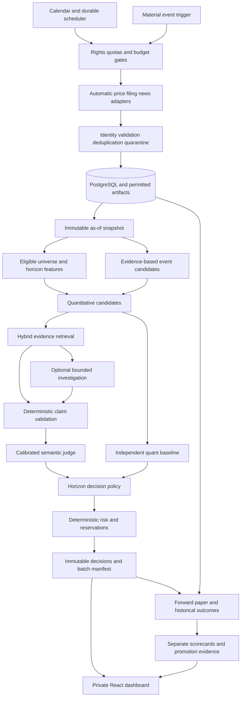
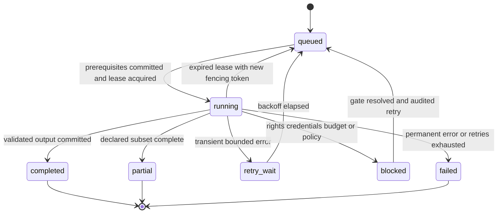

# SD ARCH 3.0 — AI-Assisted Stock Discovery & Investment Research Platform

**Consolidated architecture and implementation plan · 15 October 2026 · Owner: Gagan Jawa**
**Status: approved product decisions incorporated; design baseline frozen; implementation and activation not performed.**
Design traceability: STK-001, STK-002, STK-003; delivery spans the existing tickets mapped in §16. This document does not change their delivery status.

## 1. Purpose, authority and scope

Stock Discovery automatically scans eligible NSE cash equities, applies quantitative analysis, investigates company evidence with bounded AI, publishes evidence-backed research decisions, and measures outcomes. Reliability takes precedence over AI sophistication. Publishing no picks is a valid result. Manual uploads are not the normal operating workflow.

The platform supports three first-class horizons on shared infrastructure:

| Horizon | Intended holding period | Scheduled reassessment | Principal analysis |
|---|---|---|---|
| `swing` | 2–10 trading days | Every completed exchange session | Trend, breakout, momentum, liquidity, volatility and near-term catalysts |
| `short_term` | 1–3 calendar months | Weekly | Earnings, business changes, valuation and price confirmation |
| `long_term` | 1–5 calendar years | Monthly | Financial quality, business durability, governance, valuation and thesis evolution |

Material events trigger reassessment between scheduled runs. They do not turn this into a continuous intraday execution service. Each decision selects an exact intended holding endpoint within its horizon; the horizon range is not permission to change an unsuccessful forecast after publication.

**Approved direction:** automatic full eligible NSE coverage, staged initial smaller universe; quantitative-first grounded hybrid RAG; a bounded investigation agent; deterministic claim validation plus a calibrated LLM judge; AI-assisted event discovery and ranking; deterministic risk authority; BUY, WATCH, AVOID and INSUFFICIENT EVIDENCE; paired comparative evaluation and forward paper tracking.

**Scope boundary:** single-owner private research and paper portfolios, React/TypeScript, FastAPI, Python worker, PostgreSQL, selected Hetzner CX23/Linux/Docker Compose, encrypted restic/Backblaze B2 backup design. No orders, shorts, leverage, derivatives, paid calls, purchases, provider activation or deployment are authorized by this document. Read-only broker integration is optional later work. IPO and intraday research retain their separate roadmap tickets; neither blocks the three-horizon cash-equity platform.

### 1.1 Precedence and change control

This document supersedes the proposed SD ARCH 2.0 product scope and conflicting older roadmap statements: short-term and long-term research are core requirements, not indefinite future additions; full eligible NSE scanning is the target; WATCH/AVOID replace the proposed research use of WAIT; event-originated candidates are permitted. The first implementation slice may remain swing, but it must not be called complete SD ARCH 3.0.

Existing recommendation 1.0.0, evaluation 1.0.0, capital/risk and daily outcome 1.1 contracts keep their meanings for existing records. Changes below are additive, explicitly versioned contracts for new records. No historical record is relabelled, reinterpreted or rewritten. Latest ticket acceptance records govern what exists; this specification governs intended behavior. Future changes require a dated amendment, affected contract versions, migration impact and acceptance evidence. Activation configuration is not silently inferred from synthetic examples.

### 1.2 Repository review and provenance

Read-only inspection on 15 October 2026 found application repository `/Users/gaganjawa/Documents/Code/stock-discovery`, HEAD `9736f40` (`STK-045 Record local daily-swing MVP software acceptance`). `/Users/gaganjawa/Documents/Code/Stock Discovery` is a reference folder, not the application repository.

The requested `/mnt/data/stock-discovery-architecture-proposed-baseline.md` was not available on this host. The same-named SD ARCH 2.0 proposed baseline was recovered from the prior local chat output at `/Users/gaganjawa/Documents/Codex/2026-10-14/referenced-chatgpt-conversation-this-is-an/outputs/stock-discovery-architecture-proposed-baseline.md`. The referenced conversation `6aca4047-a9fc-83ee-92b8-9ce4c5c94d8d` was read; its approval of the five product decisions and three horizons agrees with the current instruction.

Dirty tracked files: `backend/app/research.py`, `frontend/src/App.tsx`. Untracked work: `.idea/`, `backend/tests/test_import_preview.py`, `frontend/public/daily-prices-template.csv`, `frontend/src/ImportPreview.tsx`, `main.py`, `pyproject.toml`, `shared/stock_discovery_analysis/import_preview.py`. All are preserved. The preview-import workflow is WIP, not a replacement for automatic ingestion. Reconcile it explicitly during later implementation; do not reset or stage it as part of this design.

Reported repository checks (not rerun here): 58 application tests, 11 database cases, 7 script tests, production build/browser and local synthetic-stack acceptance. These establish neither real-source readiness nor strategy profitability. No runtime services or billable models were invoked during this design task.

## 2. Frozen decisions and activation blockers

| ID | Frozen architectural choice | Consequence |
|---|---|---|
| A01 | Three independent horizon policies on one shared platform | No duplicated live/backtest engines; no cosmetic horizon selector |
| A02 | Full eligible NSE scan, staged rollout | Freeze membership per run; report coverage honestly |
| A03 | Quantitative-first; AI research can discover and rank | Event candidates re-enter mandatory eligibility and horizon rules |
| A04 | Hybrid grounded retrieval and bounded investigation | Rights, as-of and resource limits are enforced outside prompts |
| A05 | Deterministic validation precedes calibrated semantic judging | Judge cannot repair failed arithmetic, citation or temporal checks |
| A06 | Deterministic risk has final admission authority | AI cannot raise limits, size positions or override pauses |
| A07 | Four research outputs and explicit abstention | No forced picks, manufactured confidence or hidden failures |
| A08 | Immutable inputs, decisions, assessments and outcomes | Revisions append; exact provenance is retained where lawful |
| A09 | Compare quant, quant+RAG, quant+agent and optional ML | Software acceptance and strategy promotion are separate |
| A10 | One API, one worker, PostgreSQL and artifact volume | No Redis/Celery, vector service or microservice fleet initially |
| A11 | Hetzner CX23, private access, Compose, restic/B2 | Host selection is settled; provisioning gates remain |
| A12 | ₹3,000/month planning target with hard activation budgets | No assumption that current provider prices fit the target |

The following are **activation blockers**, not requests to reconsider the architecture: permitted price/history/universe/action/benchmark sources; filing/news/embedding/AI-transfer rights; territorial compatibility; actual provider prices and credentials; initial membership/liquidity thresholds; real cost assumptions; capital and horizon risk profiles; specific model and calibrated judge thresholds; experiment splits and promotion thresholds; host region/checkout cost/key custody; off-host restoration and alert destination. Defaults in this document are engineering defaults for fixtures and capacity planning. They do not authorize spend or activate a real strategy.

A missing gate blocks only the affected capability. Mocks can exercise disabled connectors and policy contracts. No mock, manual import or synthetic outcome may be presented as completion of automatic real-data discovery.

## 3. Existing code mapped to the target

Paths in this table are relative to the inspected application repository. **Existing** means observed code, not production acceptance. **New** means specified work not yet implemented.

| Existing file/module | Observed behavior | Required extension |
|---|---|---|
| `shared/stock_discovery_analysis/data.py` | `Provenance`, clocks, candle/document/account types, adapter protocols, synthetic adapter | Rights-aware paging, watermarks, exact revisions and operational as-of repositories |
| `shared/stock_discovery_analysis/strategy.py` | `analyze`; `ema-breakout-1.0.2`, synthetic risk profile, recommendation 1.0.0 | Preserve baseline; add explicit horizon strategy registry and research/risk composition |
| `shared/stock_discovery_analysis/risk.py` | Decimal sizing and `demo_profile` | Inject approved profiles; concurrent commitments, horizon and portfolio limits |
| `shared/stock_discovery_analysis/service.py` | `freeze`, `read_frozen`, `reveal`, `scorecard` | Version dispatch, multi-horizon decisions and separate outcome revisions |
| `shared/stock_discovery_analysis/jobs.py` | Enqueue, leased jobs, pinned execution versions | Stage dependencies, occurrence keys, fenced completion and spend reconciliation |
| `worker/worker/main.py` | Re-enqueues latest stored synthetic dataset by UTC day | Exchange calendar scheduler; daily/weekly/monthly occurrences, event work, catch-up |
| `backend/app/research.py` | Sessions, dashboard, analysis/reveal, scan, replay, experiments/export; import-preview WIP | Add `/v1` operational routes without changing old payloads |
| `backend/app/explanations.py` | Optional explanation of frozen synthetic facts | Keep demonstration separate; new grounded research is pre-decision, not post-hoc explanation |
| `backend/migrations/versions/0001_research_schema.sql` | Instruments, symbols, candles, documents, facts, runs, accounts, ledger, decisions and outcomes | Add rights, revisions, chunks, claims, policies, manifests and operational state through new migrations |
| `frontend/src/App.tsx` | Dashboard/Research/Replay/Scorecard and WIP edits | Horizon/mode controls, source coverage, evidence drill-down, abstention and operations views |
| Existing contracts and validators | Strict recommendation fields, forecast/trade separation, capital rules, daily replay | Retain all v1 fixtures; add v2 fixtures/readers and horizon-specific outcome definitions |
| `docs/SIMPLE-BOARD.md`, `WORK-HANDOFF.md` | Current synthetic completion and external blockers | Later record meaningful implementation milestones; no board mutation in this delivery |

## 4. Architecture and trust boundaries



FastAPI authenticates, validates short requests and queues work. The worker owns network adapters, document parsing, calculations, research, evaluation and maintenance. Domain functions remain in `shared/stock_discovery_analysis`; they receive immutable inputs and do not perform network I/O. Provider credentials and model clients live in infrastructure modules, not domain objects.

PostgreSQL stores facts, permissions, jobs, policies, manifests, decisions and ledgers. A mounted private volume stores permitted source files and derived artifacts by hash. PostgreSQL full-text search and structured issuer/date/metric queries are mandatory. Semantic retrieval uses permitted embeddings with a bounded local similarity search over prefiltered chunks; a PostgreSQL extension is optional only after capacity/licence validation. There is no separate vector database. Until semantic retrieval is implemented, label the narrower path `lexical_structured`, not complete hybrid RAG.

The decision repository cannot access post-cutoff observations or outcome tables. Historical research disables external retrieval. The evaluator alone reads later observations, under a separate interface/database privilege where practicable. LLM tools cannot write database records, browse arbitrary URLs, execute code, access credentials, alter policy, or invoke a broker. Extracted documents are untrusted data.

## 5. Module interfaces

All names below are target internal interfaces, not claims of existing implementations. Domain calls return typed immutable records. IDs resolve against a frozen run context; callers cannot pass a mutable “latest” dataset.

```python
SourcePolicy.authorize(source_id, use, region, at) -> GrantDecision
MarketDataAdapter.fetch(request, cursor) -> Page[MarketRevision]
DocumentAdapter.fetch(request, cursor) -> Page[DocumentRevision]
AsOfRepository.snapshot(cutoff, mode, scope, revision_policy) -> SnapshotManifest
UniverseSelector.select(snapshot, universe_policy) -> UniverseResult
FeatureEngine.compute(snapshot, instrument_id, horizon_policy) -> FeatureBundle
CandidateService.discover(snapshot, features, events, policy) -> CandidateBatch
Retriever.retrieve(query, snapshot_id, rights_scope, limits) -> EvidenceBundle
Calculator.compute(formula_id, fact_ids, version) -> CalculationRecord
ResearchService.assess(candidate, evidence, research_policy) -> ResearchAssessment
ClaimValidator.validate(assessment, evidence, calculations) -> ValidationReport
JudgeService.evaluate(validated_assessment, rubric_version) -> JudgeReport
DecisionPolicy.decide(candidate, assessment, validation, judge, policy) -> DecisionDraft
RiskService.assess(draft, portfolio_snapshot, risk_policy) -> RiskDecision
Publisher.freeze(draft, risk, manifest, idempotency_key) -> Recommendation
OutcomeService.evaluate(recommendation, observation_manifest, policy) -> OutcomeRevision
JobScheduler.materialize(calendar, schedule, watermark) -> list[JobRef]
NotificationOutbox.append(publication_id, event_type, payload_hash) -> OutboxRef
```

`Page` contains records, request ID, cursor, source revision, completeness watermark, retry metadata and grant ID. Advance the watermark only after records and validation results commit together. `EvidenceBundle` contains ordered revision/chunk IDs, retrieval scores, locators, rights, coverage and missing requirements. `FeatureBundle` contains names, decimal values or explicit unavailable reasons, units, lookback, formula versions and input IDs.

Every invocation receives a `RunContext`: run ID, mode, cutoff, horizon, snapshot ID, code version, configuration hashes, permission scope, deadline and budget reservation. No implicit wall clock enters pure calculations. Interfaces distinguish `blocked_rights`, `blocked_credentials`, `blocked_budget`, `insufficient_data`, `quarantined`, `retryable_failure` and `permanent_failure`; they do not encode failures as an empty successful response.

AI tool contracts: `retrieve_evidence(issuer_id, query, allowed_types)` and `compute_metric(formula_id, fact_ids)` only. The service injects cutoff and permission filters; the agent cannot loosen them. Tool results are bounded and logged, including denials. Unit tests can implement every interface without external access.

## 6. Data and schema contracts

### 6.1 Common invariants

Use timezone-aware UTC timestamps and Asia/Kolkata session/display rules. Money/prices/ratios use finite Decimal/NUMERIC and decimal strings in JSON; quantities use whole lots. Null is unknown, never zero. IDs are opaque stable identifiers. Store content hashes of configuration, prompts, rubrics and manifests in addition to human-readable versions. Foreign keys must resolve within the declared snapshot/assessment; nonempty strings alone are insufficient.

Separate `event_at`, `period_end`, `published_at`, `available_at`, `fetched_at`, `information_cutoff_at`, `generated_at` and `decision_available_at`. Live eligibility requires publication ≤ availability ≤ fetch ≤ cutoff and closed bars. Historical fetching after cutoff is allowed only for verified archival availability of the exact revision; otherwise the feature is unavailable. Later financial restatements must not leak into earlier periods.

A live decision is available only after actual validation/publication; earliest paper entry must be later than that timestamp. Never reuse the synthetic code's simulated cutoff-plus-one-minute availability for a delayed forward run. Reconstructed availability is explicitly simulated, and never counted as prospective forward evidence.

### 6.2 Mode-specific policy

| Mode | Permitted inputs and clock | Publication and execution | Evaluation restrictions |
|---|---|---|---|
| `synthetic` | Fictional fixtures and controlled clock; fictional provenance required | Persistent synthetic label; no real instrument resolution, credentials or orders | Software/regression evidence only; never combined with real results |
| `historical_reconstructed` | Pinned archive with verified contemporary availability; external retrieval disabled | Simulated decision availability explicitly recorded alongside actual generation time; no backdated forward entries | Future observations available only to evaluator; historical AI knowledge contamination disclosed |
| `live_paper` | Actual observed/fetched data by cutoff with current grants | Actual publication time precedes entry; virtual balance, no broker order capability; missed signals cannot be recreated as prospective | Append outcomes as observations arrive; delayed/immature results remain provisional |

`shadow` is an orthogonal research/admission status, not a fourth clock mode: it may run in historical or forward-paper contexts, but cannot admit positions. `technical_only` is a cohort capability label, not an AI-success state. API defaults and scorecards must filter by both mode and cohort; the UI cannot remove these labels. Unknown modes are rejected. There is no real-money execution mode in this architecture.

### 6.3 Records and persistence

| Record / logical table | Required fields and constraints |
|---|---|
| `source_grants` | source/account, approval evidence, allowed uses, regions, expiry, quotas, retention/backup/deletion, attribution, status; unknown use denies |
| `instrument_revisions` | issuer/listing stable IDs, ISIN, dated symbol/series/provider mapping, tick/lot, sector, listing/delisting/trading status; no ambiguous mapping |
| `universe_memberships` | universe version, listing ID, valid interval, selection inputs and exclusion reason; reproducible historical membership |
| `market_revisions` | listing, interval/session, raw OHLCV, adjustment basis, source revision, clocks, grant, quality flags; unique source/revision/listing/interval |
| `corporate_actions` | action ID/type, announced/available/effective dates, ratio/cash/currency, revision and source; unsupported types explicitly flagged |
| `document_revisions` | issuer links, document kind, URL, hash, clocks, grant, permitted artifact reference, supersedes; metadata-only distinct from parsed full text |
| `document_chunks` | revision ID, page/section/table/character locator, text hash, extraction/chunk versions, optional embedding version; rights inherit from source |
| `financial_facts` | metric, raw/normalized value/unit, currency, period, scope, page/table, extraction version, validation, supersedes; scope/period mismatch rejects calculation |
| `news_events` | issuer links, type, event/publication/availability, source revisions, dedup group, materiality and status; rumours distinguished from confirmed events |
| `calculation_records` | formula/version, ordered fact IDs, units, result or failure, rounding policy; never LLM arithmetic |
| `snapshot_manifests` | exact revision IDs/hashes, universe/calendar/actions, cutoff/mode, coverage, grants and manifest hash; append-only |
| `discovery_runs` | snapshot, horizon, cohort, code/config versions, stages, timestamps, coverage counters, spend, errors; terminal partial distinct from complete |
| `candidates` | run/listing, origin `quant/event/both`, feature/rule results, baseline and rank inputs, eligibility and reason codes |
| `research_assessments` | candidate/snapshot, evidence bundle, claim IDs, thesis/counterevidence, missing data, model/prompt/retrieval/agent versions, usage, status |
| `claims` | typed factual/numeric/inference claim, source locators/fact IDs, support/contradiction links, materiality, deterministic/semantic results |
| `judge_reports` | assessment hash, judge/model/rubric/calibration versions, per-claim verdicts, uncertainty and disagreement; immutable |
| `risk_snapshots/decisions` | capital, marks, holdings/reservations, limits, costs, input hash, quantity, constraints, pause/rejection reasons |
| `recommendations_v2` | contract below; immutable payload/hash and indexed listing/horizon/mode/cutoff/action |
| `outcome_revisions` | recommendation, observation manifest, cost/evaluator policy, maturity, fills, uncertainty, metrics and superseded outcome |
| `paper_ledger/reservations` | portfolio/horizon bucket, event type, amount/quantity, fees, source decision/action, timestamp, unique execution key; double-entry or equivalent balancing checks |
| `schedule_occurrences/jobs/outbox` | logical key, dependencies, priority, lease/fencing token, cursor, attempts, result/error, delivery key |
| `experiment_registry/trial_ledger` | hypotheses, variants, splits, tuning budget, holdout access, metrics/gates, version hashes, actual trials and promotion/rollback records |
| `budget_ledger` | currency, period, limit, reserved/settled/released amounts, provider request ID and ambiguous status; atomic cap enforcement |

Index listing+availability, issuer+document kind+availability, run+horizon+cohort, and claim/evidence references. Search indexes are derived and rebuildable; immutable source revisions remain authoritative. New migrations must avoid destructive edits to v1 tables, backfill optional indexes without reinterpreting old rows, and include upgrade/repeat-upgrade/recovery tests.

### 6.4 Recommendation contract 2.0.0

Retain existing identity, instrument, mode, cutoff, generation, strategy, evidence and revision fields with unchanged temporal semantics. Add mandatory fields below; object schemas reject unknown fields. `action` uses machine enum `BUY | WATCH | AVOID | INSUFFICIENT_EVIDENCE`; UI renders the last as “INSUFFICIENT EVIDENCE”.

| Field | Type / rule |
|---|---|
| `schema_version` | Literal `2.0.0` |
| `horizon` | Profile plus exact `holding_end_at`, `min/max`, units, next review and entry expiry; exchange calendar resolves session endpoints |
| `cohort` | `quant`, `quant_rag`, `quant_agent`, or `traditional_ml`; configuration hash required |
| `candidate_origin` | `quant`, `event`, `both`; event IDs required for event origin |
| `snapshot_id`, `baseline_ref` | Frozen manifest and baseline candidate/decision for comparison |
| `research_ref`, `validation_ref`, `judge_ref` | Required for successful researched outputs; nullable with explicit unavailable reason for quant/failed research |
| `policy_refs` | Strategy, horizon, research, risk, cost, retrieval, schedule and universe versions/hashes |
| `evidence_quality` | Coverage, freshness, source quality, claim support, contradictions, uncertainty, missing required fields; no implied win probability |
| `conditions` | Structured entry prerequisites, invalidations, expiry and re-review triggers with human-readable explanations |
| `valuation` | Optional deterministic scenario range, currency, valuation date, assumptions/calculation IDs; distinct from trading target |
| `execution` | Horizon-specific paper entry/exit plan or null; BUY requires valid entry conditions, invalidation and expiry |
| `risk_context` | Eligibility, binding constraints, risk reference; no invented quantity when capital profile absent |
| `paper_admission` | `not_requested`, `admitted`, `blocked`, `expired`; reservation ref and reason; quantity only when admitted |
| `action_reason_codes` | Stable nonempty array; includes material failure/adverse evidence IDs where applicable |
| `revises_id`, `revision_reason` | Null for first record; append-only link for reassessment; no in-place action change |

V2 research concerns opening/avoiding long exposure. Existing v1 SELL records remain valid holding exits. AVOID is not a sell instruction and must not be mapped to SELL. Holding reductions/thesis exits are separately recorded portfolio-review events with acquisition-lot linkage; they never open shorts.

V1 WAIT may be displayed as legacy WAIT. A compatibility view may group it under “waiting” but cannot infer whether it meant WATCH, AVOID or risk rejection. V1 readers remain unchanged; v2 uses a separate reader and explicit negotiation. Outcomes use a new horizon-aware schema `2.0.0`; daily v1.1 semantics remain available. Update contract docs, JSON schemas, fixtures and validators together before application migration.

## 7. Universe, ingestion and as-of pipelines

1. Read permitted instrument master, dated status, calendar and corporate actions. Define eligible NSE cash-equity series in policy; exclude unsupported instruments, suspended/untradeable listings, unknown identity and insufficient history. BSE identifiers can support evidence reconciliation without implying BSE scanning.
2. Freeze the full universe denominator. Apply cutoff-known liquidity/data-quality rules. Keep both exclusions and eligible membership; do not filter delisted history out using today's membership.
3. Start rollout with 50–100 mechanically selected liquid listings; expand in measured batches to the full eligible universe. Initial N, liquidity window/thresholds and exclusions are configuration gates. A manual watchlist supplements but cannot substitute for discovery.
4. Fetch permitted prices and company evidence automatically with paging, quotas and watermarks. Validate chronology, duplicate keys, OHLC consistency, units, session gaps, zero volume, symbol changes, stale data and revision conflicts. Quarantine instead of silently splicing providers or adjustment bases.
5. Preserve raw executable prices. Compute adjusted features using only cutoff-known actions under a pinned adjustment version. Evaluators process split/dividend/delisting transformations explicitly. Unsupported action windows are excluded with counts, never silently treated as normal.
6. Parse allowed documents in bounded processes; deduplicate exact and near duplicates, retaining original source attribution. Extract period/scope-aware facts; deterministic reconciliation catches inconsistent totals and units. Do not infer missing customer concentration or management quality from absent disclosures.
7. Materialize immutable snapshot, horizon features and coverage manifest. Partial source availability can produce a visibly partial batch. It cannot be titled a completed full-market scan.

Coverage counters must reconcile: `universe_total = ineligible + eligible`; `eligible = screened + unscreened`; `screened = candidate + noncandidate`; `candidate = research_complete + research_pending + research_failed + research_not_selected` for the declared research cohort. Multiple outcomes use separate dimensions, not overlapping counts. Track eligible fraction, data-complete fraction and researched fraction separately. Every excluded listing has at least one reason.

Source grants are checked before acquisition, storage, extraction, embedding, external-model transfer, historical use, paper evaluation and export. Private access does not establish those rights. Metadata-only access cannot support full-text claims. Revocation disables dependent jobs, clears disallowed caches and applies deletion rules to artifacts/derived data/backups; preserve permitted audit tombstones and disclose loss of reproducibility. Provider/territorial terms require review at activation; no present legal clearance is asserted here.

## 8. Scheduling, events and failure handling

Schedules are in Asia/Kolkata and resolved using the exchange calendar, including special sessions. Proposed engineering defaults: begin readiness checks at session close +30 minutes, retry at 15-minute intervals within quotas, stop new swing publication attempts 60 minutes before the next session opens. Weekly short-term review uses the last trading session of each calendar week; monthly long-term review uses the last trading session of each month. Persist schedule policy/version and exact resolved timestamps. A calendar correction creates an audited revision.

Poll permitted event sources hourly 08:00–20:00 IST plus a check 60 minutes before the next session opens. Outside that window, display monitoring as inactive; do not promise overnight or continuous coverage. Material events include earnings/restatements, significant orders or cancellations, financing/defaults, management/auditor changes and regulatory disclosures. Classification proposes issuer/event associations; validated source identity and deterministic materiality rules determine reassessment. Deduplicate by issuer/event/source revision; coalesce repeated events while preserving each source.

An event may nominate a listing outside the quant shortlist, but only inside the declared eligible universe. It must pass the same data, liquidity and horizon rules before BUY. It can become WATCH while investigation is incomplete. Material adverse evidence can pause pending admission and queue reassessment; previously published decisions and fills remain immutable. Portfolio-wide macro events affect relevant open theses through bounded fan-out jobs.



At-least-once execution uses transactional idempotency: job key includes kind, schedule occurrence, scope, horizon, snapshot/input hash and code/policy versions. Completion requires a current fencing token. A stale worker cannot publish after its lease expires. Data writes and dependent-job creation commit together; publication and notification-outbox insertion commit together. Unique reservation/execution keys prevent duplicate cash use.

Priority: safety/event checks and due outcomes, current ingestion/discovery, then replay and maintenance. Chunk large scans and experiments so they yield to urgent work. Default maximum three transient execution attempts with exponential backoff/jitter and Retry-After. Credentials/rights/budget failures block instead of retrying indefinitely. An ambiguous billable request retains its reservation until provider usage is reconciled; do not blindly resend.

After restart, fetch missing data and evaluate frozen decisions. Missed decisions may be reconstructed with the historical label; they cannot become forward signals retroactively. Database unavailability halts publication and reservations. A failed or partial batch leaves the previous complete batch visible with its true age. Empty successful scans display “no qualifying picks”; outages display their failure, never “no picks”.

## 9. Horizon policies and research outputs

### 9.1 Horizon-specific requirements

| Policy | Swing | Short term | Long term |
|---|---|---|---|
| Quant anchor | Existing EMA/breakout/relative-volume baseline; ATR geometry | Earnings/financial momentum, valuation and price confirmation | Financial quality, leverage/cash generation, valuation and durability proxies |
| Required evidence | Fresh closed bars, calendar/actions, material-event coverage and relevant filings | Latest available results with comparable periods, material events, valuation inputs and prices | Available annual/interim financials, cash flow/debt, governance disclosures, business/thesis evidence and valuation inputs |
| Entry | Trigger/cap, stop, target, expiry | Entry zone and prerequisites, downside/invalidation rules, expiry | Valuation/accumulation conditions, tranche limits, thesis invalidation, entry-window expiry |
| Position review | Every session plus events | Weekly plus events | Monthly plus events |
| Exit evaluation | Stop/target/time exit under pinned fill policy | Predeclared price/thesis/time rules; no hindsight exit choice | Thesis/valuation/concentration/time rules and distributions; interim marks remain provisional |
| Risk | Gap/slippage, liquidity, per-trade and concurrent exposure | Earnings/event exposure, downside and sector concentration | Issuer/sector concentration, valuation uncertainty, liquidity and aggregate capital commitment |
| Outcome endpoint | Exact 2–10 session choice | Exact 1–3 month date, resolved to calendar policy | Exact 1–5 year anniversary, resolved to calendar policy |

The existing synthetic strategy remains exactly `ema-breakout-1.0.2`: EMA10 > EMA30, close above prior 20-session high, relative volume ≥1.5, ATR14; entry above decision high, stop two ATR below entry, two-risk-unit target, 1% entry cap, two entry sessions, three holding sessions, separate five-session forecast. Its fictional tick/cost/risk settings are not activated for real instruments. New swing configurations choose their exact holding/forecast endpoints explicitly; do not reinterpret old three/five-session records.

Short-term and long-term formulas, eligibility thresholds, sector-specific metric substitutions, evidence ages and valuation assumptions must be registered before real activation. Until present, those policies return INSUFFICIENT EVIDENCE with `policy_not_configured`. Numeric thresholds are intentionally not invented. Implementers can build the policy engine and fixtures now without claiming a validated investment strategy. Calendar-month/year endpoints use a pinned preceding-valid-session convention; entry after expiry is forbidden. Review frequency and holding endpoint are distinct.

### 9.2 Decision policy and precedence

Evaluate in order:

1. Invalid/missing mandatory input, unconfigured policy, failed deterministic validation or unavailable required research → INSUFFICIENT EVIDENCE. Record known adverse facts even if the overall evidence is insufficient.
2. With sufficient validated evidence, a hard strategy disqualifier, verified material adverse finding or prohibited risk condition → AVOID, with explicit reason and re-entry/review conditions.
3. Sufficient evidence but entry/valuation/confirmation conditions not yet met → WATCH, with explicit trigger and expiry.
4. Required quantitative/horizon conditions, validated research (for AI cohorts), and deterministic safety gates satisfied → BUY, conditional on its published entry terms.

A portfolio capacity shortage does not turn a sound research BUY into a false adverse thesis. Keep `action=BUY`, `paper_admission=blocked`, quantity null and a capacity reason. Unknown capital/marks blocks personalized admission; it need not erase non-personalized research. Known instrument risk prohibitions prevent BUY. This separation is mandatory in the UI.

AI may adjust a bounded, versioned ranking component, identify adverse evidence, propose event candidates and downgrade readiness. It cannot edit computed features, financial facts, prices, stops, capital, limits or eligibility results. Use a deterministic sort key: action tier, horizon quant score, bounded AI component, stable listing ID; weights/normalization are fixed before evaluation. Persist every component. Event candidates receive the same horizon scoring; there is no AI bypass around a failed mandatory rule.

Do not produce BUY simply to fill a top-N list. Unresearched candidates remain visibly technical-only. AI failure leaves the independent quant cohort intact but the researched cohort unavailable; it cannot silently borrow the quant BUY label as successful AI research.

## 10. Grounded hybrid RAG, agent and judge

### 10.1 Retrieval and evidence assembly

Pre-filter by issuer/listing, grant, document type, exact as-of availability and permitted revision. Combine structured fact queries, lexical search and semantic similarity. Fuse ranked lists with a deterministic reciprocal-rank method, versioned weights and stable tie-breaking; reranking may be added only as a separately measured component. Apply filters before similarity search and validate again after retrieval. Store query, selected chunks, scores, coverage and omitted requirements.

Initial bounded profile: top 10 research candidates per horizon occurrence, at most 20 evidence chunks per candidate, and configurable token/byte ceilings. Reserve a configurable share of research slots for valid event candidates so technical rank cannot starve them. The selected cap and allocation are recorded; unresearched eligible candidates count as incomplete research, not negative evidence. Full quant scanning does not imply full-document AI coverage of every NSE listing.

Use identical bundle/model/prompt hashes for permissible cache reuse. Deduplicate syndicated stories so ten copies do not become ten independent confirmations. Prefer attributable primary disclosures; identify source quality and conflicts rather than assuming every filing is true. Financial ratios use deterministic calculation records with compatible scope/period/units. Valuation scenarios show assumptions and sensitivities; valuation ranges are not trading targets.

### 10.2 Bounded investigation

`quant_rag` uses a fixed evidence bundle and one structured research response. `quant_agent` starts from the same candidate/bundle and may investigate missing information with at most four read-only tool calls and one final response, under a default 120-second wall-time ceiling. Each tool has row/byte limits; failed calls count toward the cap. No recursive agent spawning, unrestricted browsing or self-modifying plan is allowed.

Stop on sufficient evidence, exhausted limits, deadline, rights denial or budget cap. Return the actual missing requirements and tool trace. Any repair attempt is separately budgeted and logged, at most one; it cannot relax validation or increase the overall configured ceiling. Per-run/day/month reservations include retrieval embeddings, research, judge and repairs, not just final text generation.

### 10.3 Validation and semantic judgment

Deterministic checks run first: strict JSON schema; allowed action enum; citation membership and locators; as-of and grant validity; issuer identity; number/unit/period/scope parity with facts; arithmetic via formula records; required fields; unsupported URLs; and prohibited tool actions. Any material failing claim prevents researched BUY. Inferences are marked as inferences and cite their premises; a citation alone does not prove support.

The judge examines semantic support, contradictions, completeness, reasoning and appropriate abstention, using a frozen rubric and the same eligible source bundle. It does not judge expected stock returns. It cannot override deterministic failures. Avoid circular validation: an assessment is not evidence for itself; the judge reads source extracts. Prefer an independent judge configuration and measure correlated failure; using a different model alone is not proof of independence.

Calibrate against a human-labelled set spanning all horizons, supported/unsupported claims, unit and period traps, stale information, contradictory reports, insufficient coverage and prompt injection. Split rubric-development and held-out cases by issuer/document family and time where possible. Preserve reviewer labels, disagreements and adjudication. Report false acceptance of material errors, false rejection, abstention, coverage and agreement with uncertainty intervals. Freeze acceptance thresholds before held-out evaluation; record sample size and limitations. No numeric “confidence of profit” is derived from judge scores.

Until calibration gates pass, run AI research as shadow/non-actionable output. For a configured gate, a material unsupported claim, unresolved contradiction or below-threshold assessment produces INSUFFICIENT EVIDENCE or WATCH only when missing information is nonblocking under explicit policy. Persist both validator and judge reports. Human review can add a new reviewed assessment; it cannot mutate an old one or waive deterministic risk.

### 10.4 Evidence quality shown to the owner

Display separate dimensions: source reliability, required-evidence coverage, freshness, supported material-claim fraction, numerical reconciliation, unresolved contradictions and model/coverage limitations. An aggregate label such as low/medium/high requires a versioned rubric and must be described as **evidence quality**, not success probability. Show what would change the decision and the next scheduled review. Missing adverse-news coverage must never become “no adverse news exists”.

## 11. Deterministic risk and paper portfolio

Retain STK-003 separation of contributions, unallocated cash, active paper allocation and long-term allocation. Illustrative amounts and percentages in earlier documents are not approved funding or risk settings. Each activated profile specifies active capital, reserve, per-trade loss budget, combined open/pending risk, issuer/sector limits, horizon buckets, daily/monthly pause limits, mark freshness, cost schedule and override/review authority.

Select the largest whole-lot quantity satisfying available cash, fees, risk and exposure simultaneously. Recompute nonlinear costs at the trial quantity. Preserve the effective capital base `min(approved ceiling, frozen period base, current equity)`. Include pending reservations, existing holdings and cross-horizon exposure to the same issuer. Stale/missing required marks, unknown sector or unsupported fees block admission. An AI score cannot enlarge the budget.

One transactional portfolio lock or equivalent serializable reservation process admits candidates in deterministic rank order. The same cash cannot be committed separately to swing and long-term portfolios unless actual capital buckets are separated and reconciled. Release reservations on expiry/cancellation; convert them atomically to fills. Portfolio pause remains latched until the configured review process clears it.

At entry, recheck validity, source/event freshness, expiry, price cap, available capital and action status using only then-available observations. Historical simulations use then-available event clocks; forward paper uses actual publication timing. Gaps may exceed stop assumptions. Daily bars cannot prove intrabar ordering, queue priority, full liquidity or exact stop fills; preserve ambiguity and conservative bounds.

Maintain chronological cash, positions, fees, receivables/dividends, corporate actions and external contributions. AVOID is a research state, not a short or automatic exit. Read-only broker holdings, if later enabled, are reconciled snapshots with independent permissions; no broker is required for initial paper capital. All broker order interfaces remain absent/disabled.

## 12. Evaluation, experimentation and promotion

### 12.1 Required experiment arms

| Arm | Contents | Comparison purpose |
|---|---|---|
| Q | Deterministic eligibility, horizon quant policy and risk | Baseline |
| Q+R | Same foundation plus fixed hybrid RAG assessment | Incremental grounded research effect |
| Q+A | Same foundation plus bounded investigation | Incremental investigation effect over fixed RAG |
| Q+ML (optional) | Traditional supervised model with train-only preprocessing | Incremental predictive model effect; not a release prerequisite |

Run two complementary experiments: **paired assessment**, using identical candidates/snapshots/cost/risk assumptions to isolate research effects; and **end-to-end discovery**, allowing event-originated candidates and recording candidate selection/coverage differences. Do not attribute an improved universe to better judgment on a paired set. Compare against Q, cash and a permitted universe-appropriate benchmark. Distinguish full-capital and exposure-matched returns.

### 12.2 Leakage and split controls

Register hypothesis, horizon, candidate selection, exact dated train/validation/test periods, features, costs, benchmarks, minimum samples, stopping rules, tuning budget and primary metrics before observing outcomes. Chronological training precedes validation and untouched test. Fit preprocessing/imputation/calibration only on training; select models and thresholds on validation. Lock holdout access, record every trial, and treat repeated test-driven changes as new experiments with new holdouts.

Purge training labels that overlap validation/test label windows and embargo boundaries according to the maximum actual label span. Group related issuer/event/document samples to avoid duplicate leakage. Five-year labels may require very long histories and gaps; the former EP-1 minimum 30-month proposal cannot establish five-year performance. Use horizon-specific maturity and sample requirements. Insufficient independent history means “not established”, not relaxed splits.

Use point-in-time universe membership, financial publication dates, original revisions and corporate actions. Historical LLM weights may contain later information despite as-of retrieval. Therefore historical AI-assisted results remain exploratory; verified forward paper results are mandatory for promotion. Do not claim clean historical model knowledge merely because prompts are date-filtered.

### 12.3 Metrics and outcome contracts

Track all decisions including no picks, WATCH, AVOID, insufficient evidence, failed research, no-entry and ambiguous cases. Separate forecast direction, target attainment, target-before-stop, execution rate, net expectancy and portfolio return; keep eligible/resolved/missing/ambiguous denominators visible. Net results include actual configured fees, spread/slippage and cost stress. Report turnover, exposure, concentration, drawdown, coverage, latency and AI cost per researched candidate/accepted decision.

Portfolio returns come from the chronological ledger, with external flows removed; never sum independent trade examples into a portfolio curve. Missing benchmark/marks yield unavailable comparisons. Long-term outcomes remain provisional until their endpoints mature; interim thesis checks and mark-to-market are not evidence of a completed five-year strategy. Separate thesis accuracy from realized returns.

Use uncertainty estimates appropriate to time/issuer dependence (for example blocked resampling), with method, sample size and limitations. Avoid treating overlapping daily recommendations as independent observations. Risk-adjusted statistics with inadequate samples are unavailable. Negative results and exclusions remain in the trial ledger.

### 12.4 Promotion and rollback gates

Software correctness, research quality, operational release and investment-strategy promotion are four independent approvals. Existing EP-1 numeric proposals remain unratified; do not activate or rewrite them here. Before promotion, freeze horizon-specific sample/maturity thresholds, data coverage, cost stress, drawdown limits, benchmark criteria and forward duration. If any required threshold is unset, promotion is blocked.

A challenger must pass contract/leakage tests, held-out research-quality checks, registered out-of-sample comparisons and prospective forward tracking. Report whether improvements survive costs and uncertainty; do not invent profitability or promise an edge. Human promotion records exact artifact hashes, evidence and rollback target. Degradation monitors use sample-aware windows; data-quality/risk failures can pause immediately, whereas noisy short-run returns do not automatically retrain or change policy. Rollback changes future runs only and preserves prior records.

## 13. API and user experience

Preserve existing synthetic routes. New operational API uses `/v1`; long operations return HTTP 202 plus run ID and status URL. Authenticated writes require idempotency keys. A duplicate key with identical body returns the original result; a different body is a conflict. Reads use stable cursor pagination. Error payloads contain a stable code, safe message, retryability and related run/gate IDs, never credentials.

| Endpoint | Contract |
|---|---|
| `GET /v1/discovery?horizon=&mode=&cohort=` | Latest published batch, coverage, timestamps, freshness, candidates and explicit empty/failure states |
| `POST /v1/discovery-runs` | Horizon/scope/policy refs; same scheduler path; no direct synchronous full scan |
| `GET /v1/runs/{id}` | Stages, counters, failures, budget and artifact refs |
| `GET /v1/recommendations/{id}` | Immutable versioned recommendation, evidence and risk/admission detail |
| `GET /v1/evidence/{id}` | Only permitted stored content/locator and attribution; metadata-only is explicit |
| `POST /v1/replay-runs` | Pinned snapshot/date range/experiment refs; no current-news access |
| `GET /v1/scorecards` | Horizon/mode/cohort/version/maturity filters and denominator definitions |
| `GET /v1/sources` | Rights, credential status, quotas, watermarks and incidents |
| `GET /v1/paper-portfolio` | Cash/positions/reservations/exposure, virtual label and reconciliation |
| `GET /v1/operations` | Schedule, lag, spend, jobs, disk and backup health |

Default landing view is automatic discovery with horizon tabs, data-through timestamp, declared universe, coverage, last/next run and source issues. Distinguish synthetic, reconstructed, forward-paper and shadow research persistently. Recommendation detail shows quantitative conditions, thesis, counterevidence, cited sources, uncertainty, expiry, risk limits and paper-admission status. Valuation ranges and trade targets use different labels.

Show “no qualifying picks”, “partial scan”, “required evidence missing”, “research budget exhausted” and “source unavailable” as different states. A research BUY blocked from paper admission must not display a purchasable quantity. Expired decisions remain visible as historical. In-app notifications are deduplicated by decision/event revision. External email/chat alerts remain disabled until destination and sending authorization are configured.

## 14. Security, operations and cost envelope

Keep selected Hetzner CX23 Linux/Compose deployment design and private owner access. API, worker, PostgreSQL and proxy are the initial services. Do not reopen hosting selection or add infrastructure to compensate for an unmeasured bottleneck. No hardware capacity or current price is asserted without verification at activation.

Preserve secure HttpOnly signed sessions, origin/CSRF protections, login throttling, least-privilege database/runtime users, private database networking and explicit HTTPS configuration. Secrets remain server-side in restricted files or encrypted storage with independent key custody. Logs and prompts must exclude credentials/account tokens. Allowlist document hosts, revalidate redirects and block private/link-local destinations to prevent SSRF. Parse PDFs/HTML with size/time/memory limits; reject archive bombs and unsafe active content. Render AI text safely and validate outbound links.

Source text and tool output cannot authorize a new tool call, spend, permission change or instruction override. Test prompt injection in documents and malicious citation URLs. Keep dependency notices, chart attribution and native/host licence checks as release gates. Audit privileged changes and policy versions. Historical outcome permissions must not leak into the decision path.

Initial engineering capacity targets (not measurements): 100 listings and top 10 research candidates per horizon occurrence; technical scan within 15 minutes of a validated snapshot, complete bounded research within 60 minutes under configured quotas. Expansion requires load tests at the actual eligible-universe count, meeting next-run deadlines without starving outcomes/events or exceeding memory/disk/spend caps. Failure leads to a visible staged scope, not a false full-coverage label. Schedule bulk replay locally or in maintenance windows; optional ML training does not require a persistent new service.

Back up database and referenced artifacts consistently with encrypted nightly restic snapshots to B2 when authorized. Target RPO ≤24 hours, attended RTO ≤8 hours; validate by restoration into an isolated environment, manifest/hash reconciliation and a working read-only smoke flow. Keep keys separately; test unavailable-key handling, off-host loss, credential rotation and retention/deletion compatibility. Local restoration evidence is not off-host recovery acceptance.

Monitor calendar/source lag, universe coverage, queue age, lease failures, research validation/abstention, provider quotas, token and currency spend, storage, backup age and external heartbeat. Critical alerts require a tested destination; in-app-only status cannot report a dead host. One-host failure is an accepted availability limitation, not hidden redundancy.

₹3,000/month is a planning target covering hosting, data, AI/embeddings/judges, backups, taxes/FX and other necessary services. The former ₹900 AI allowance and historical hosting estimates are not current quotations. Before activation, record approved invoices/limits and reserve worst-case usage atomically per request/run/day/month. Hard-cap rejection blocks research; do not overspend to complete a scan. Cache only when rights and exact inputs/versions permit. Meter failed/retried/ambiguous calls and show reserved versus settled spend. No paid call is needed to validate the software with deterministic mocks.

## 15. Acceptance and test matrix

These are required future tests, not results claimed by this document.

| ID | Test / failure injection | Required result |
|---|---|---|
| T01 | All existing v1 fixtures; unknown v2 fields; WAIT/SELL compatibility | V1 unchanged; strict v2 validation; no fabricated legacy mapping |
| T02 | Future filing, late fetch, restatement, unclosed bar, changed calendar | Excluded or explicitly reconstructed; no future evidence in decision |
| T03 | Rights revoked/expired, denied embedding/AI export, territorial mismatch | Affected operation denied before transfer; audit/tombstone retained as permitted |
| T04 | Duplicate/revised prices, symbol change, stale facts, unit/scope mismatch | Correct revision selected or quarantine; no silent zero/substitution |
| T05 | Universe expansion, delisted member, missing instrument data | Frozen denominator, reproducible membership, reconciled partial coverage |
| T06 | Event outside shortlist; duplicated news; false issuer association | Valid eligible event candidate investigated; deduplication; no eligibility bypass |
| T07 | Prompt injection, invented citation/number, contradiction, judge disagreement | Tool boundary holds; material invalid claims block researched BUY |
| T08 | Retrieval golden queries across horizons | As-of/rights-safe relevant chunks; measured recall/support with misses visible |
| T09 | Agent loop, oversized response, timeout, exhausted budget | Bounded termination, abstention and recorded usage; no hidden retries/spend |
| T10 | Concurrent horizon admissions, nonlinear fees, stale marks, latched pause | No double cash use; deterministic whole-lot sizing; blocked invalid admission |
| T11 | Gap, stop/target same bar, expiry, split/dividend/delisting | Honest fills/ambiguity or explicit unsupported exclusion; no favorable hindsight |
| T12 | Worker crash before/after commit, lost lease, DB outage, duplicate outbox | No duplicate decision/reservation/ledger event; stale worker fenced |
| T13 | Missed schedules, holiday/week/month boundary, restart | Correct occurrence/catch-up; missed decisions never relabelled forward |
| T14 | Overlapping labels, repeated holdout access, later financial revision | Purge/embargo and access controls work; leakage recorded/rejected |
| T15 | All four experiment arms, zero picks, failed AI, immature long-term cohort | Correct independent cohorts, denominators and unavailable metrics |
| T16 | Deposit/withdrawal, missing marks, sector/issuer overlap | Flow-neutral returns and defined unavailable states; concentration across horizons |
| T17 | 100-listing pilot then actual full eligible-universe load | Measured deadlines/resources/cost; scope label matches tested coverage |
| T18 | Credential expiry, backup restore, host loss, rollback, failed alert | Secure fail-closed behavior and measured recovery; no assumed delivery |
| T19 | UI/API evidence, action, mode and freshness states | No misleading BUY/quantity, no hidden failure, accessible evidence/unknowns |

Minimum end-to-end acceptance: automatic scheduled ingestion → invalid listing exclusion → frozen universe/snapshot → quant and event candidates → supported financial calculation → retrieved and investigated evidence → validation/judge → four-action policy → deterministic admission → immutable publication → entry/expiry → automatic outcome and scorecard. Run across all three horizon profiles with accelerated fictional clocks, then permitted source samples. Repeat with missing filing, denied rights, failed AI, duplicate job, corporate action and ambiguous bar. Fictional clock tests establish horizon handling, not years of investment evidence.

## 16. Ticket-by-ticket implementation plan

Existing IDs are preserved. Rows below specify **remaining work or amendments**, not reopening completed historical scopes. New design subtasks use local labels `D3-*` until recorded under their mapped STK ticket; these are not invented tracker IDs. Keep one implementation task in progress and one in review per the existing plan. No tracker/status changes are part of this deliverable.

### 16.1 Ordered delivery packages

| Package | Dependency | Mapped tickets and concrete deliverable | Exit gate |
|---|---|---|---|
| D3-01 Contract amendment | This baseline | STK-001/002/003: v2 recommendation/outcome schemas, horizon/policy schemas, compatibility fixtures, risk/admission split | T01/T02/T15; old fixtures byte-semantically unchanged |
| D3-02 Rights and source feasibility | Independent, before real use | STK-004/005/006/007: use-specific grants, source coverage/territory/cost matrix and denied-operation cases | T03; required real-use grants recorded or explicit blockers |
| D3-03 Revision storage and ingestion | D3-01; mock grants available | STK-014/015/019/020/021/022/023/024: additive schema, adapters, memberships/actions, manifests and quarantine | T02/T04/T05/T11; migration/recovery checks |
| D3-04 Scheduling and coverage | D3-03 | STK-017/058/060/073: durable occurrences, staged universe, dependency jobs, event hooks and counters | T05/T12/T13; unattended mocked runs |
| D3-05 Quant horizon policies | D3-01/03 | STK-028–032/054/058/076: preserve swing baseline, register short/long policies and deterministic feature/valuation interfaces | T01/T02/T10; configured policies or explicit unavailable states |
| D3-06 Evidence ingestion | D3-02/03 | STK-046–051: automatic filings/news, extraction, facts, events, citations and coverage | T03/T04/T06; real-source activation separately gated |
| D3-07 Hybrid RAG | D3-05/06 | STK-052/053/074: structured/lexical/semantic retrieval, calculation tools, fixed RAG cohort, budgets | T07/T08/T09; lexical-only fallback correctly labelled |
| D3-08 Bounded agent and judge | D3-07 | STK-052/070/071/072: bounded investigation, deterministic validation, calibrated rubric and shadow cohort | T07–09; reviewed holdout gates before actionable AI |
| D3-09 Policy publication and UI | D3-05/07/08 | STK-033/054/058/059: four-action policy, event ranking, evidence quality, v2 API and horizon dashboard | T06/T15/T19; no-pick and failure states distinct |
| D3-10 Paper portfolio and outcomes | D3-03/05/09 | STK-037–044/060–063: capital reservations, ledger, horizon outcomes and automatic tracking | T10/T11/T12/T16; no broker dependency |
| D3-11 Experiment governance | D3-10 | STK-041/042/044/069/072/076–078: trial registry, paired/end-to-end arms, holdout and forward cohorts | T14/T15; promotion unset thresholds block |
| D3-12 Private operational pilot | D3-02/04/09/10 and explicit deployment authorization | STK-009/016/017/018/073–075: actual host hardening, budgets, monitoring and off-host recovery | T17/T18; actual permissions/costs/restore evidence |
| D3-13 Three-horizon release | D3-11/12 | STK-079/080/081: integrated evidence and runbook, known limits, coverage and measured results | T01–19; all horizon functions accepted, no profitability inference |

The first useful pilot is permitted daily swing discovery with forward paper tracking. Next deliver short-term and long-term functional profiles, event reassessment and their evaluation plumbing. No months/years of waiting are required to accept software using fixtures; actual performance claims require matured observations. Optional ML follows a stable data/evaluation foundation and is not on the release critical path.

### 16.2 Exact ticket extensions and boundaries

| Existing ticket | Implementation-specific scope / acceptance |
|---|---|
| STK-001 | Version 2.0.0 contract, four actions, horizon and evidence fields; preserve completed v1 scope |
| STK-002 | Horizon-aware metrics/splits/maturity and comparison registry; EP-1 remains proposed until configured |
| STK-003 | Cross-horizon capital/reservations and research/admission separation; do not activate illustrative limits |
| STK-004 | Broker/data terms assessment for history, retention, hosting, paper, ML and external AI |
| STK-005 | Alternative/direct source coverage and written quotes where needed; no purchase |
| STK-006 | Private-use scope review and documented unresolved regulatory/provider questions |
| STK-007 | Automatic filing/news/IR routes and extraction/embedding/transfer rights; manual route only fallback |
| STK-008 | Retain completed Hetzner CX23/restic/B2 selection; verify activation costs separately |
| STK-009 | Close native/host licence and notice gaps before deployment |
| STK-014/015 | Extend existing adapter/storage boundaries without breaking synthetic fixtures |
| STK-016/017/018 | Private access, durable execution and actual recovery/release evidence; local foundation remains partial |
| STK-019–024 | Preserve delivered synthetic history foundation; add real dated universe/actions/ingestion acceptance, especially STK-020 action gaps |
| STK-025/026/027 | Optional authorized broker reads/feed integration only if chosen source requires it; no orders |
| STK-028–033 | Keep existing indicators/strategy/risk evidence; new profiles via registry and explicit v2 presentation |
| STK-034/035/036 | Optional additional strategies and ablations; not a substitute for evaluating baseline |
| STK-037/038/039/040 | Extend freeze/reveal, fills/costs/outcomes to real actions and horizon plans; preserve ambiguity semantics |
| STK-041 | Full chronological portfolio and permitted benchmark; existing single-slot report remains scoped |
| STK-042 | Complete overlap-aware split, untouched holdout, trial ledger and sample-aware uncertainty |
| STK-043/044 | Versioned multi-horizon replay/batches/export, failure-inclusive audit and nonblocking scheduling |
| STK-045 | Preserve local synthetic MVP acceptance; real historical/private acceptance remains separate |
| STK-046 | Automatic permitted filings and source revisions; deduplicate exchange copies |
| STK-047 | Annual reports/IR evidence required for long-term; IPO documents only for later IPO scope |
| STK-048 | Reconciled facts with units, scope, period and page/table citations |
| STK-049 | Allowed news text/metadata ingestion with coverage and retention |
| STK-050 | Event taxonomy, issuer mapping and materiality; distinct clocks |
| STK-051 | As-of feed and event-trigger queues; current news excluded from replay |
| STK-052 | Hybrid retrieval and bounded agent as separate experimental variants |
| STK-053 | Horizon research templates, deterministic calculations and counterevidence |
| STK-054 | Amend old buy/sell/wait research scope to approved four actions; holding exits remain separate |
| STK-055/056/057 | IPO roadmap retained; not required for this three-horizon release claim |
| STK-058 | Extend bounded-universe scanner to staged full eligible NSE, all horizons and event origin |
| STK-059 | Horizon dashboard, conditions, evidence quality, deduplicated in-app alerts |
| STK-060 | Daily/weekly/monthly/event scheduling and prospective paper tracking with true timestamps |
| STK-061 | Paper ledger/reservations first; optional broker reconciliation later |
| STK-062 | Cross-horizon exposure, net P&L and concentration with known capital |
| STK-063 | Holding-specific thesis/exit reviews; manual fallback never primary discovery input |
| STK-064/065/066 | Intraday roadmap retained; hourly event checks do not claim intraday execution readiness |
| STK-067 | Optional point-in-time ML labels/features with overlap separation |
| STK-068 | Optional simple model, bounded tuning and train-only preprocessing/calibration |
| STK-069 | Untouched and forward comparisons for ML, compatible with shared experiment registry |
| STK-070 | Reviewed research failures, adversarial sources and horizon-spanning gold cases |
| STK-071 | Calibrated judge implementation; DeepEval optional test harness, not required runtime service |
| STK-072 | Failure taxonomy and quantitative ablations; distinguish retrieval, reasoning and strategy failures |
| STK-073 | Feed/queue/coverage/latency/heartbeat dashboards and actionable alerts |
| STK-074 | Atomic all-component AI budgets, lawful caching, retention and ambiguous-spend handling |
| STK-075 | Off-host restore, rollback, outages and credential revocation with measured evidence |
| STK-076 | Immutable strategy, horizon, model, prompt, retrieval, rubric and policy registry |
| STK-077 | Sample-aware degradation monitoring; deterministic safety pauses |
| STK-078 | Recorded promotion/rollback against preregistered gates; no self-promotion |
| STK-079 | Three-horizon E2E failure matrix; IPO/broker scenarios only when those optional features activate |
| STK-080 | Actual rights, licence, security, recovery and budget review |
| STK-081 | Scoped release/runbook and truthful results; no implied completion of optional IPO/intraday/ML/order scope |

Before later marking STK-079–081 Done, explicitly reconcile their original broader v1.0 scope with this release slice. Completing SD ARCH 3.0 cash-equity scope cannot silently mark unrelated IPO/intraday requirements complete. No new delivery dates, effort estimates or percentage-complete claims are invented here.

## 17. Release gates and unresolved configuration register

| Gate | Evidence required | What remains disabled until satisfied |
|---|---|---|
| G0 Design | This consolidated specification and repository mapping | Completed by this documentation delivery; does not start app implementation |
| G1 Contracts | v2 schemas/fixtures, migration and v1 compatibility tests | New v2 publication |
| G2 Source rights | Use/region/retention grants, coverage, credentials and real samples | Corresponding automatic real-source operations |
| G3 Quant and risk | Versioned formulas, thresholds, costs, capital and pause limits | Actionable real-data policy/admission affected by missing values |
| G4 Research | Working automatic evidence pipeline, deterministic checks, calibrated judge, budgets and transfer rights | Actionable AI-assisted BUY; shadow output can remain clearly labelled |
| G5 Paper/evaluation | Ledger invariants, costs/actions, split controls and prospective logs | Reliable portfolio/performance claims |
| G6 Operational | Authorized provisioning, actual HTTPS/firewall, licence clearance, tested off-host restore and external alerts | Private deployed release |
| G7 Strategy promotion | Predeclared sample/maturity/performance gates plus out-of-sample and forward evidence | Promotion beyond research/shadow status |
| G8 Full coverage | Capacity test and membership accounting for all eligible NSE listings | “Full eligible NSE scan” claim |

Activation register must store setting, owner, status, evidence, effective date, review date and affected gate. Required entries: price/history provider; instrument/calendar/action source; benchmark; filing/news source; legal uses/host territory; liquidity and universe configuration; short/long formulas and evidence-age rules; model/embedding/judge versions; calibration set/thresholds; token/time/currency caps; capital/risk/cost settings; dated experiment splits and sample thresholds; host region/price/access identity; backup region/key custody/retention; alert destination. Unknown settings fail closed. There is no need to reopen the five approved product decisions.

## 18. Document delivery and verification record

This artifact is the finished consolidated SD ARCH 3.0 specification. It includes approved decisions, repository reconciliation, architecture and job-state diagrams, interfaces, schema contracts, mode/horizon policies, data/research pipelines, risk/evaluation controls, ticket mapping and acceptance gates. It supersedes SD ARCH 2.0's approval request; no further architecture approval is solicited.

Integrated at repository `docs/SD-ARCH-3.0.md` on 15 October 2026 as the authoritative design specification. README, the lightweight board and work handoff link to this baseline. Architecture and product decisions are frozen; D3-01 through D3-13 remain unstarted. The owner's latest instruction explicitly excludes implementation. No app/schema/validator changes, deployments, paid calls or broker actions are included. Existing synthetic contracts and unrelated WIP remain unchanged. Documentation integration is separate from implementation-ticket completion; no ticket is marked Done by this integration. No commit or push is included in this documentation integration.

Review sources: recovered SD ARCH 2.0 baseline; approved conversation and current instruction; repository `README.md`, `docs/SIMPLE-BOARD.md`, `docs/WORK-HANDOFF.md`, `docs/DAILY-SWING-MVP.md`, `docs/stock-platform-kanban-plan.md`, `docs/STK-001.md`, the existing recommendation/evaluation/daily replay contracts, and code/schema paths in §3. Current provider pricing or legal permissions were not revalidated; they remain explicit activation gates, with no present compliance or affordability claim.

Document checks cover required sections/actions/horizons, internal section references, fenced code blocks, repository path traceability and ticket IDs. Application tests are not rerun for this documentation-only artifact. No app code, existing WIP, deployment, paid service, broker state or implementation-ticket status was changed. Local documentation now records the architecture integration and implementation hold.


## 19. D3-01 implementation authorization — 15 October 2026

The subsequent owner instruction supersedes the implementation hold recorded in §18: integrate this specification and implement, test, commit and push **D3-01 only**, mapped to STK-001/002/003. The original design-delivery record above is retained as history. [D3-01 contract amendment](contracts/v2/README.md) documents the additive v2 schemas, validators, fixtures and compatibility boundary. Existing v1 runtime and historical evaluation fixtures remain unchanged. D3-02 is not authorized in this task. No paid API, purchase, external deployment or broker order is included.

## REAL-001 implementation note — 19 October 2026

The owner authorized REAL-001 after D3-10 merged at `a0846b5`, reusing D3-01 through D3-10. [Real integration acceptance](REAL-001-acceptance.md) supersedes older activation status only for its explicitly recorded checks. Documented Upstox endpoints were reached using an owner-provided read-only Analytics Token; native Ollama performed bounded generation and embedding calls. This does not grant storage/AI/replay rights, qualify a financial model, or complete G2/G4/G5. The new infrastructure adapters use D3-02/03 boundaries and a D3-04 price handler; the existing D3-09 React app exposes blocked real readiness. D3-10 remains unchanged and no real forward publication/outcome is claimed. REAL-001 is PARTIAL; D3-11/12/13 are out of scope.

REAL-001 Phase 2 reuses D3-06 ingestion, D3-07/08 execution and D3-05 assessments
through configured real-source adapters and permission-aware reads. D3-07 results
remain analysis history, not D3-09 publication or D3-10 prospective records.
Actual acceptance is blocked and publication/tracking are unfinished; see
[Phase 2 progress](REAL-001-phase2.md). No architecture qualification gate changed.

REAL-001 Phase 3 adds a real-context branch to the existing D3-09 assembler and
uses its existing publication storage/outbox. D3-10 shadow references/observation
receipts freeze research independently of portfolios, fills and performance
formulas. No admission gate changed. Mature real returns remain blocked by
missing qualified corporate-action coverage. Current source rights protect
original and subsequent evidence reads. [Phase 3 acceptance](REAL-001-phase3.md)
records partial software delivery separately from blocked actual INFY acceptance.
